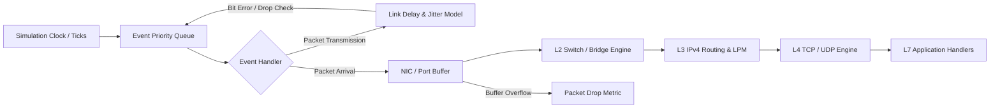

<div align="center">

# 🌐 NetPulse

### Interactive Network Protocol Visualizer & Discrete-Event Simulator

[](https://react.dev/)
[](https://www.typescriptlang.org/)
[](https://vitejs.dev/)
[](https://tailwindcss.com/)
[](https://web.dev/progressive-web-apps/)
[](LICENSE)
[](https://netpulse.itgg.space)

<p align="center">
  <strong>Understand how the internet truly works.</strong><br>
  Explore 39 networking protocols with step-by-step packet animations, inspect raw bytes in a Wireshark-grade protocol dissector, and design, test, and break real network topologies using a browser-based discrete-event simulation engine.
</p>

[✨ Explore Features](#-key-features) • [🚀 Quick Start](#-quick-start) • [📡 Supported Protocols](#-supported-protocols-matrix) • [🔬 Simulation Engine](#-discrete-event-simulation-engine) • [🧪 Testing](#-testing--quality)

---

</div>

## 🌟 Overview

**NetPulse** is an educational workbench and network laboratory that runs **100% in the browser** without external backends. Built from the ground up in pure TypeScript, it bridges the gap between static textbook diagrams and production networking tools like Wireshark and Cisco Packet Tracer.

Whether you are studying for **CompTIA Network+**, **CCNA**, computer science university exams, or debugging distributed architectures, NetPulse gives you full X-ray visibility into every layer of the OSI model: from physical copper and fiber cables up through Ethernet frames, IP routing, TCP congestion control, and modern application protocols like HTTP/3, TLS 1.3, and BGP.

---

## ⚡ Key Features

### 1. 🔍 39 Interactive Protocol Explorers
- **Layer-by-Layer Visualizations**: Step forward and backward through protocol handshakes, state transitions, and packet lifecycles.
- **Dynamic Scenario Scaffolding**: Toggle real-world conditions like packet drops, latency spikes, TCP out-of-order reassembly, and TLS cipher negotiation.
- **Comparative Diff Mode**: Compare protocol pairs side-by-side (e.g., `HTTP/1.1 vs HTTP/2 vs HTTP/3`, `TCP vs UDP`, `IPv4 vs IPv6`, `RIP vs OSPF vs BGP`).

### 2. 🔬 Wireshark-Grade Packet Dissector & Hex Inspector
- **Full Bitfield Breakdown**: Dissects raw packet structures down to individual flag bits (SYN/ACK/FIN, DF/MF, DSCP/ECN, TTL, Type/Code).
- **RFC 1071 Checksum Verification**: Live checksum recomputation for IPv4 headers, TCP pseudokeys, UDP payloads, and ICMP checksums.
- **Interactive Hex Dump**: Color-coded hexadecimal and ASCII dump synced directly to highlighted fields in the protocol header.
- **Display Filters**: Wireshark-compatible display filter engine supporting expressions like `tcp.port == 80`, `ip.src == 192.168.1.10`, `icmp.type == 8`, and `dns.flags.response == 1`.
- **PCAP File Export**: Export recorded captures directly to standard `.pcap` files compatible with Wireshark and `tcpdump`.

### 3. 🖥️ Interactive Discrete-Event Network Simulator
- **Visual Topology Drag-and-Drop Canvas**: Build custom networks with over 20+ isometric hardware devices.
- **Physical Cabling Bay**: Connect interfaces using **Copper Ethernet** (100 Mbps), **Fiber Optic** (1 Gbps), **Serial WAN** (10 Mbps), or **Wireless RF** (300 Mbps).
- **Accurate Routing & Forwarding**:
  - Longest Prefix Match (LPM) routing table lookups.
  - Layer-2 MAC learning, aging, and frame flooding.
  - Dynamic ARP resolution and ARP cache caching.
  - NAT / PAT (Port Address Translation) tracking.
- **Built-in Terminal Emulator**: Access device CLI prompts with standard networking utilities: `ping`, `traceroute`, `ifconfig`, `route`, `iptables`, `arp`, and `netstat`.

### 4. 🛡️ Security & Enterprise Gateway Simulation
- **Stateful Packet Inspection (SPI)**: Track TCP connection states (`NEW`, `ESTABLISHED`, `RELATED`).
- **Firewall ACL Engine**: Create stateless and stateful firewall rules to allow or deny traffic by port, IP, and protocol.
- **SYN Flood & SYN Cookies**: Simulate Denial-of-Service attacks and observe how cryptographic SYN cookies protect server backlogs from resource exhaustion.

### 5. 🛠️ Interactive Educational Tools & Labs
- **Pre-Configured Labs**: Step-by-step challenges covering DHCP address leasing, VLAN trunking, multi-hop OSPF routing, NAT gateways, and DDoS mitigation.
- **Subnet Calculator**: Visual IPv4 CIDR calculator with network address, broadcast address, usable IP range, and binary wildcard masks.
- **Bandwidth-Delay Product (BDP) Calculator**: Compute pipe capacities and optimal TCP window sizes.
- **Interactive Quizzes & Minigames**: Test protocol knowledge with interactive challenges and terminal games.

### 6. 🌍 Multilingual & Offline PWA
- **6 Supported Languages**: English, Spanish, Arabic (with complete RTL layout), Hindi, Malayalam, and Tamil.
- **Progressive Web App**: Fully functional offline with automated service worker caching.

---

## 📡 Supported Protocols Matrix

NetPulse includes 39 meticulously modeled network protocols across all layers:

| Layer | Protocols Modeled |
| :--- | :--- |
| **Application (L7)** | **HTTP/1.1**, **HTTP/2**, **HTTP/3 (QUIC)**, **DNS**, **DHCP**, **SMTP**, **SSH**, **FTP**, **WebSocket**, **NTP**, **SNMP**, **MQTT**, **BGP**, **gRPC** |
| **Transport (L4)** | **TCP** *(3-Way Handshake, 4-Way Teardown, Reno/CUBIC Congestion Control, Fast Retransmit, SACK)*, **UDP** |
| **Network & Internet (L3)** | **IPv4**, **IPv6**, **ICMP** *(Ping, Unreachable, Time Exceeded)*, **ICMPv6**, **ARP**, **OSPF**, **RIP**, **NAT / PAT**, **IPSec** |
| **Data Link (L2)** | **Ethernet II (802.3)**, **Wi-Fi (802.11)** *(Beacon, Probe, 4-Way WPA2/WPA3 Handshake)*, **VLAN (802.1Q)**, **STP (802.1D)**, **PPP** |
| **Security & Cryptography** | **TLS 1.3** *(ECDHE Key Exchange, Certificate Validation, Handshake Secrets)*, **TLS 1.2**, **WPA2-PSK**, **WPA3-SAE**, **SSHv2 Transport** |

---

## 🔬 Discrete-Event Simulation Engine

NetPulse uses an asynchronous, deterministic discrete-event simulation engine written without external runtime dependencies:



### Key Engine Features:
- **RFC 1071 Checksum Engine**: Verifies one's complement sums over 16-bit words for IPv4, TCP, UDP, and ICMP.
- **Link Physical Modeling**: Simulates cable propagation delay, configurable bandwidth constraints, random jitter distributions, and MTU fragmentation thresholds.
- **TCP Congestion Control State Machine**: Implements Slow Start, Congestion Avoidance, Fast Retransmit, and Fast Recovery using standard RFC 5681 equations.

---

## 🚀 Quick Start

### Prerequisites
- [Node.js](https://nodejs.org/) (v18.0.0 or higher recommended)
- `npm`, `pnpm`, or `bun`

### Installation

1. **Clone the repository:**
   ```bash
   git clone https://github.com/geevarghesekthomas84-sys/NetPulse.git
   cd NetPulse
   ```

2. **Install dependencies:**
   ```bash
   npm install --legacy-peer-deps
   ```

3. **Start the local development server:**
   ```bash
   npm run dev
   ```

4. **Open in your browser:**
   Navigate to [http://localhost:3000](http://localhost:3000) (or `http://localhost:3001`).

---

## 🛠️ Scripts & Commands

| Command | Action |
| :--- | :--- |
| `npm run dev` | Starts Vite dev server with Hot Module Replacement (HMR) |
| `npm run build` | Compiles TypeScript and creates optimized production bundle in `dist/` |
| `npm run preview` | Previews the production build locally |
| `npm run test` | Runs the Vitest test suite (Unit & Integration tests) |
| `npm run lint` | Runs `tsc --noEmit` to verify TypeScript types |
| `npm run test:e2e` | Runs Playwright browser verification script |

---

## 📐 Project Architecture

```
NetPulse/
├── public/                 # Static assets, PWA icons, manifest & robots.txt
├── src/
│   ├── components/
│   │   ├── common/         # Header, BrandLogo, PacketInspector, Modals, Tour
│   │   ├── explore/        # Protocol visualizer, sequence diagram, packet table, OSI ruler
│   │   ├── simulator/      # Topology canvas, hardware palette, properties panel, controls
│   │   └── learn/          # Quizzes, networking tools, reference cheat sheets
│   ├── engine/             # Pure TypeScript discrete-event simulation kernel
│   │   ├── simulator.ts    # Main event loop & device coordinator
│   │   ├── l2l3.ts         # MAC learning, ARP resolution, LPM routing table lookups
│   │   ├── tcp.ts          # TCP Reno/CUBIC congestion control & sequence reassembly
│   │   ├── packetBuilder.ts# Protocol packet serializers & header decoders
│   │   └── types.ts        # Protocol, hardware, packet, and topology type definitions
│   ├── lib/                # Checksum, pcap writer, display filter, audio & deep links
│   ├── protocols/          # Comprehensive 39 protocol definitions & animation scenarios
│   ├── simulator/          # Pre-built lab scenarios and starter network templates
│   ├── store/              # Zustand application state management
│   ├── i18n/               # Localization dictionaries (en, es, ar, hi, ml, ta)
│   ├── tests/              # Vitest unit and integration test suites
│   ├── App.tsx             # Root application workspace router
│   ├── index.css           # Tailwind CSS & precision daylight/ocean design tokens
│   └── main.tsx            # Application entry point
├── package.json
├── tsconfig.json
└── vite.config.ts          # Vite build config with Tailwind & PWA plugin
```

---

## ⌨️ Keyboard Shortcuts

| Shortcut | Description |
| :--- | :--- |
| <kbd>Space</kbd> | Toggle Simulation Play / Pause |
| <kbd>→</kbd> | Step forward one tick / animation state |
| <kbd>←</kbd> | Step back one tick |
| <kbd>R</kbd> | Reset current simulation or protocol scenario |
| <kbd>M</kbd> | Switch between Live Mode and Step-by-Step Mode |
| <kbd>/</kbd> | Open quick protocol search |
| <kbd>Ctrl</kbd> + <kbd>K</kbd> / <kbd>⌘</kbd> + <kbd>K</kbd> | Open Global Command Palette |
| <kbd>Esc</kbd> | Close inspector, modals, or active toolbars |

---

## 🧪 Testing & Quality

NetPulse maintains strict automated testing across simulation mechanics, checksum calculations, and protocol dissections:

```bash
npm run test
```

```text
 ✓ src/tests/unit/svgViewport.test.ts (4 tests)
 ✓ src/tests/unit/simPlayback.test.ts (12 tests)
 ✓ src/tests/unit/engine-core.test.ts (8 tests)
 ✓ src/tests/unit/simAnalytics.test.ts (4 tests)
 ✓ src/tests/unit/utils.test.ts (8 tests)
 ✓ src/tests/integration/simulator-labs.integration.test.ts (4 tests)
 ✓ src/tests/unit/i18n.test.ts (7 tests)
 ✓ src/tests/integration/protocols.integration.test.ts (2 tests)
 ✓ src/tests/unit/exportTopologyPng.test.ts (3 tests)
 ✓ src/tests/unit/store.test.ts (3 tests)
 ✓ src/tests/integration/ui-components.integration.test.tsx (9 tests)

 Test Files  11 passed (11)
      Tests  64 passed (64)
```

---

## 🤝 Contributing

Contributions, bug reports, and protocol scenario additions are warmly welcomed!

1. Fork the Project
2. Create your Feature Branch (`git checkout -b feature/AmazingProtocol`)
3. Commit your Changes (`git commit -m 'Add support for WebSocket subprotocols'`)
4. Push to the Branch (`git push origin feature/AmazingProtocol`)
5. Open a Pull Request

---

## 📄 License

Distributed under the **Apache License 2.0**. See [`LICENSE`](LICENSE) for more information.

---

<div align="center">
  <sub>Designed with precision by <strong>Geevarghese K Thomas</strong>. Built for students, engineers, and educators worldwide.</sub>
</div>
