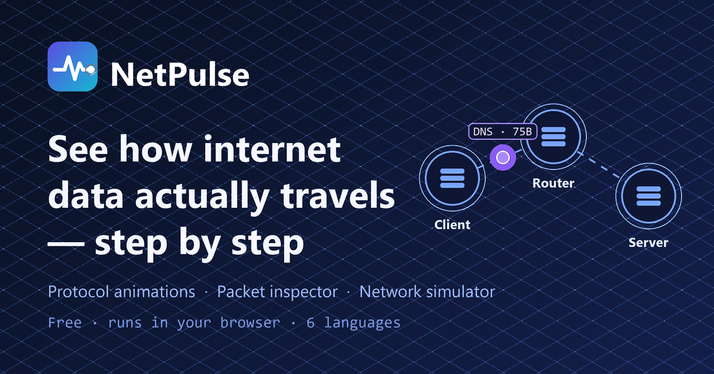

<div align="center">


# NetPulse

### Watch the internet work. Build and break your own networks.

[](https://netpulse.itgg.space)
[](LICENSE)
[](#testing)

<p>
  
  
  
  
  
  
</p>

**Interactive internet protocols, a Wireshark-style packet inspector and a Packet Tracer-style network simulator.**<br>
Everything runs in your browser: no sign-up, no tracking, nothing uploaded.

[**Launch the app**](https://netpulse.itgg.space) ·
[Features](#features) ·
[Quick start](#quick-start) ·
[Project layout](#project-layout) ·
[Testing](#testing)



</div>

---

## Why NetPulse

Textbooks show static diagrams. Wireshark shows thousands of lines of raw hex. Packet Tracer is a heavy desktop
install. NetPulse lets you **see** a packet travel hop by hop, **inspect** every byte, then **build and break** a
network of your own, all in one browser tab.

It is made for students, teachers and engineers preparing for Network+, CCNA or a networking course, and for anyone
curious about how the internet works.

## Features

### Explore: 39 protocols, step by step
- Animated exchanges for DNS, TCP, TLS, HTTP, BGP, DHCP, Ethernet and more, with plain-English notes at every step.
- A **follow-the-step camera** that glides to the devices in play, a sequence-diagram view, and a step details panel.
- A **packet inspector**: layered fields with byte ranges, colour-coded hex dump, hover a field to light up its bytes.
- **What-if switches** (packet loss, closed port, expired certificate, small MTU) and side-by-side protocol compare.
- **Import `.pcap` files** from Wireshark or tcpdump; the file is read locally and never uploaded.
- Read-aloud captions, in the selected language where the device has a voice.

### Simulator: a Packet Tracer-style workbench
- Drag routers, switches, PCs, servers and firewalls onto a canvas and cable them (copper, fibre, serial, wireless).
- **IOS-style CLI** on routers and switches: user / privileged / config modes, `?` help, tab completion, `no` forms.
  `interface`, `ip address`, `shutdown`, `vlan`, `switchport`, `ip route`, `router ospf|rip|bgp` with `network`
  statements, `ip nat`, `access-list`, `ip helper-address`, and `show ip route | interface brief | vlan brief |
  running-config | cdp neighbors | ip protocols` and more.
- Configuration is real: change an address, shut a port or remove a `network` line and traffic reacts.
- **DHCP** (including relay across a router), a **PC desktop** with IP configuration and a command prompt.
- **Add PDU**: send a test packet between any two devices and follow every event hop by hop.
- Live metrics, ARP / MAC / routing / NAT tables, fault injection, undo and redo, and a follow-the-packet camera.
- 20 guided labs, from a home network to BGP failover.

### Learn
- Quizzes on all 39 protocols, with a **review round** for the questions you missed.
- Port and packet-order games, **"Break it"** troubleshooting challenges, a subnet calculator and a glossary.
- A daily learning streak.

### Everywhere
- **Six languages**: English, Español, العربية, हिन्दी, മലയാളം, தமிழ், with right-to-left layout.
- Light and dark themes, a mobile layout, keyboard shortcuts, and installable offline use (PWA).

## Quick start

```bash
npm install --legacy-peer-deps
npm run dev          # http://localhost:3000
```

| Command | What it does |
| --- | --- |
| `npm run dev` | Start the dev server |
| `npm run build` | Production build in `dist/` |
| `npm run preview` | Serve the production build locally |
| `npm test` | Run the unit and integration tests |
| `npm run lint` | Type-check with `tsc --noEmit` |

## Project layout

| Path | What lives there |
| --- | --- |
| `src/engine/` | The discrete-event network engine: packets, TCP, routing, the IOS-style CLI (`ios.ts`), DHCP, PDUs |
| `src/protocols/` | The 39 protocol scenarios (steps, packets, quizzes) |
| `src/components/explore/` | Explore diagram, step panel, packet table, capture viewer |
| `src/components/simulator/` | Canvas, device palette, properties panel, terminal, PDU and desktop windows |
| `src/components/learn/` | Quizzes, review, games, challenges, tools |
| `src/components/landing/` | Landing page |
| `src/components/icons/WireDevices.tsx` | Isometric wireframe device art |
| `src/i18n/` | UI strings per language, plus `content/` translations of the lesson text |
| `src/tests/` | Unit and integration tests |
| `public/` | Icons, fonts, share image, `robots.txt`, `sitemap.xml` |
| `docs/` | The built site that GitHub Pages serves |

## Translations

UI text lives in `src/i18n/<lang>.json`, and a test keeps all six languages in step. Lesson text is translated
through English-keyed dictionaries in `src/i18n/content/<lang>.json`; a test fails if an entry is missing or stale.

## Saved data

Settings and progress live in your browser under `netpulse-*` keys. Older `gg-*` keys are moved over automatically
the first time the app loads.

## Testing

```bash
npm test
```

250 tests cover the engine (CLI, routing, DHCP, PDUs), protocol scenarios, translations, theme contrast, exports and
the main screens.

## Deploying

`npm run build` runs `vite build` and then `scripts/prerender.mjs`, which writes a real HTML page for every route
(`/explore/dns/`, `/protocols/`, `/simulator/`, `/learn/`, `/about/`) with its own title, description, canonical URL,
structured data and readable text, plus `sitemap.xml`, `llms.txt` and `robots.txt`. React replaces that text when the
app starts, so visitors get the interactive app and crawlers get real content.

GitHub Pages serves this repository from `main` → `/docs`. To publish an update:

```bash
npm run build
rm -rf docs && cp -r dist docs && touch docs/.nojekyll
git add -A && git commit -m "Publish build" && git push
```

## License

[Apache License 2.0](LICENSE). Monospace type is [Iosevka](https://typeface.app/iosevka) (SIL Open Font License).
