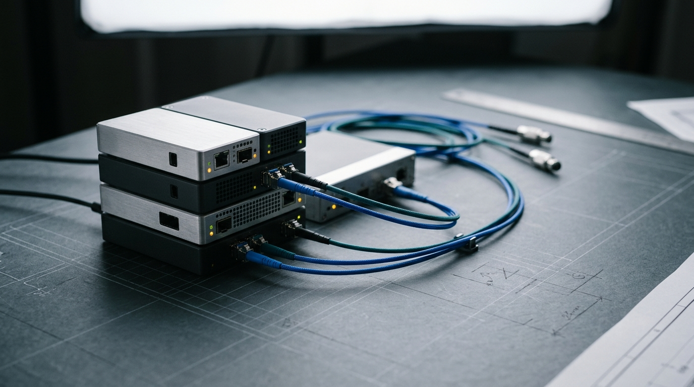
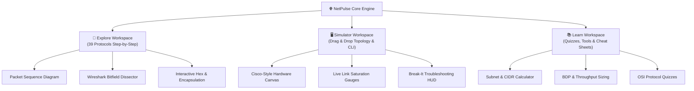
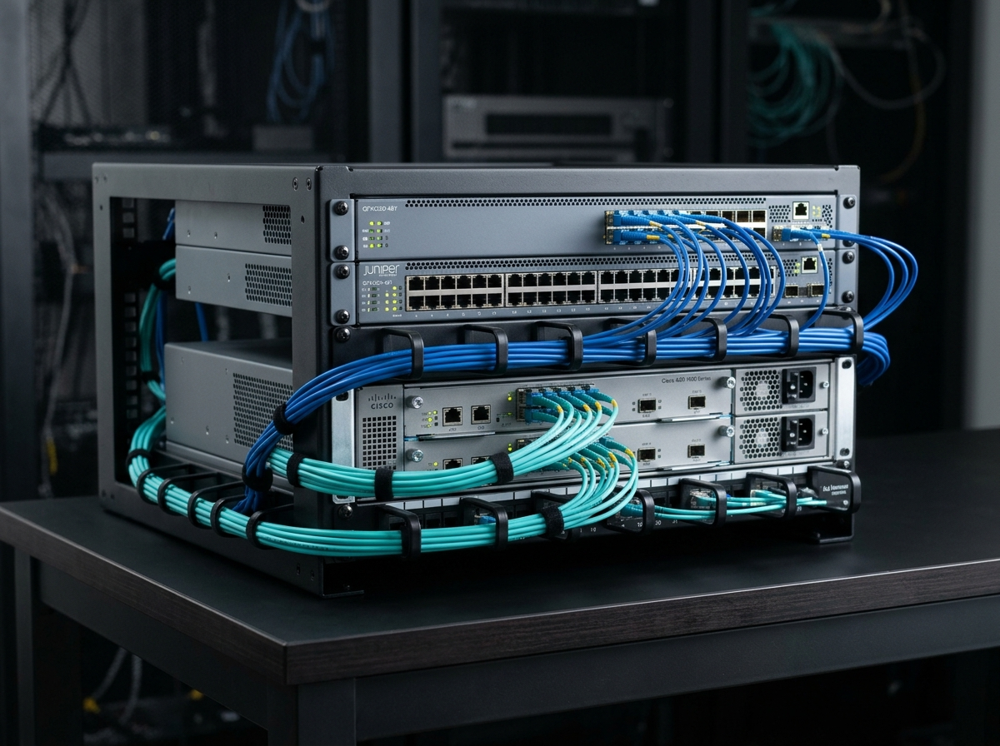

<div align="center">


# 🌐 NetPulse

### The Ultimate Interactive Network Protocol Visualizer & Discrete-Event Simulator

[](https://netpulse.itgg.space)
[](https://github.com/geevarghesekthomas84-sys/NetPulse/stargazers)
[](LICENSE)
[](https://vitest.dev/)

<p align="center">
  <a href="https://react.dev/"></a>
  <a href="https://www.typescriptlang.org/"></a>
  <a href="https://vitejs.dev/"></a>
  <a href="https://tailwindcss.com/"></a>
  <a href="https://web.dev/progressive-web-apps/"></a>
  <a href="https://en.wikipedia.org/wiki/OSI_model"></a>
</p>

<p align="center">
  <strong>Demystify how the internet truly works.</strong><br>
  Explore <strong>39 networking protocols</strong> with live step-by-step packet handshakes, dissect raw binary bitfields in a Wireshark-grade inspector, and build, test, and troubleshoot enterprise networks in a browser-based discrete-event simulation engine with realistic Cisco-style hardware.
</p>

<p align="center">
  <a href="https://netpulse.itgg.space"><strong>🚀 Launch Interactive App</strong></a> •
  <a href="#-key-capabilities"><strong>✨ Features</strong></a> •
  <a href="#-the-three-workspaces"><strong>🖥️ Workspaces</strong></a> •
  <a href="#-supported-protocols-matrix"><strong>📡 39 Protocols</strong></a> •
  <a href="#-quick-start"><strong>⚡ Quick Start</strong></a> •
  <a href="#-testing--quality"><strong>🧪 Tests</strong></a>
</p>

---



</div>

---

## 💡 Why NetPulse?

> *"Textbooks show static diagrams. Wireshark dumps thousands of cryptic raw hex bytes. Cisco Packet Tracer is heavyweight and proprietary. **NetPulse makes networking visible, tangible, and fun.**"*

NetPulse was engineered for **students**, **network engineers**, **educators**, and **software architects** preparing for **CompTIA Network+**, **Cisco CCNA/CCNP**, or university Computer Systems courses.

It runs **100% client-side in the browser** with **zero server dependencies**, zero tracking, zero installation friction, and full offline PWA support.

---

## ⚡ Key Capabilities

### 🔍 1. Interactive Protocol Visualizer (39 Protocols)
* **Step-by-Step Handshake Animator**: Walk forward and backward through TCP 3-way handshakes, TLS 1.3 ECDHE key exchanges, DNS recursive lookups, and BGP route advertisements.
* **What-If Scenario Sandbox**: Inject real-world failure modes in one click: dropped packets, high latency jitter, MTU fragmentation, TCP out-of-order reassembly, and closed ports.
* **Comparative Protocol Diffs**: Compare protocols side-by-side (e.g. `HTTP/1.1 vs HTTP/2 vs HTTP/3`, `TCP vs UDP`, `IPv4 vs IPv6`, `RIP vs OSPF`).

### 🔬 2. Wireshark-Grade Packet Dissector & Hex Inspector
* **Full Bitfield Breakdown**: Inspect exact header structures down to individual bit flags (SYN/ACK/FIN, DF/MF, DSCP/ECN, TTL, Type/Code).
* **Interactive Encapsulation Visualizer**: Watch data transform as it travels down the stack: `L7 Payload` $\rightarrow$ `L4 TCP Segment` $\rightarrow$ `L3 IPv4 Packet` $\rightarrow$ `L2 Ethernet Frame` with live byte offsets.
* **RFC 1071 Checksum Verification**: Real-time one's complement checksum calculation for IPv4 headers, TCP pseudokeys, UDP payloads, and ICMP checksums.
* **Interactive Hex & ASCII Dump**: Synced color highlighting connecting raw bytes directly to protocol header fields.
* **PCAP Import & Export**: Replay Wireshark `.pcap` capture files directly in the visualizer, or export simulation traffic to `.pcap` / `.csv`.

### 🖥️ 3. Discrete-Event Network Simulator
* **Visual Topology Drag-and-Drop Canvas**: Build custom enterprise networks with realistic photorealistic hardware.
* **Realistic Enterprise Hardware Models**: Modern aluminum laptops, Cisco Catalyst rack switches, enterprise gateways, dual-antenna Wi-Fi routers, 2U Dell/HPE server blades with hot-swap drive bays, and Next-Gen Firewalls.
* **High-Tech Directional Photon Animation**: Flying cyber data capsules with link tangent vector chevrons (`>>`/`<<`), motion trails, and anti-collision badge elevation.
* **Live Link Bandwidth & Saturation Gauges**: Real-time throughput load meters (`⚡ 100 Mbps · 67% load`) with dynamic color shifts (blue $\rightarrow$ amber $\rightarrow$ congested red).
* **Severed Wire Electrical Sparks FX**: Disconnected links trigger realistic spark bursts, hazard warning halos, and `LINK DOWN` alert pills.
* **Built-in Device CLI Terminal**: Run real commands: `ping`, `traceroute`, `ifconfig`, `route`, `iptables`, `arp`, and `netstat`.
* **L2/L3 Forwarding**: Longest Prefix Match (LPM) IP routing, dynamic ARP caching, MAC address table learning, and NAT/PAT translation.

### 🔧 4. "Break-It" Interactive Troubleshooting Missions
* **5 Real-World Break-It Missions**: Solve pre-configured faulty networks (broken gateways, blocked firewall rules, subnet mask mismatches, dead DNS resolvers, and severed trunk cables).
* **Real-Time Verification Engine**: Click **"Verify Fix"** to execute automated diagnostic probes, complete with investigation clues, diagnostic hints, and victory fanfare chimes.

### 🎧 5. Web Audio Datacenter Sound Suite (0KB Assets)
* **Pure Browser-Synthesized Audio**: Tactile RJ-45 cable click-snaps, packet transmission chirps, severed link unplug sounds, and celebratory 3-tone victory chimes.
* **One-Click Mute Toggle**: Dedicated volume button on the HUD control island.

---

## 🖥️ The Three Workspaces



<div align="center">

| Explore Mode | Topology Simulator |
| :---: | :---: |
|  |  |
| *Deep bitfield breakdown & encapsulation viewer* | *Enterprise rack hardware with live bandwidth meters* |

</div>

---

## 📡 Supported Protocols Matrix

NetPulse includes **39 meticulously modeled network protocols** spanning all 7 OSI layers:

| Layer | Protocol | Key Scenarios & Concepts Modeled |
| :--- | :--- | :--- |
| **L7 Application** | **HTTP/1.1** | Keep-alive, pipeline stalls, chunked transfer encoding, headers |
| | **HTTP/2** | Binary framing, stream multiplexing, header compression (HPACK) |
| | **HTTP/3** | QUIC UDP transport, 0-RTT connection resumption, zero head-of-line blocking |
| | **DNS** | Iterative vs recursive resolution, Root/TLD/Authoritative hierarchy, A/AAAA records |
| | **DHCP** | DORA sequence (Discover, Offer, Request, Acknowledge), IP address leasing |
| | **WebSocket** | HTTP Upgrade handshake, bi-directional full-duplex binary framing |
| | **BGP** | Exterior Gateway Protocol, AS-path attributes, prefix route announcements |
| | **SMTP** | Email relaying, `HELO`, `MAIL FROM`, `RCPT TO`, `DATA`, `QUIT` |
| | **SSHv2** | Transport handshake, Diffie-Hellman Key Exchange, encrypted payload |
| | **NTP** | Clock synchronization, stratum hierarchy, round-trip delay timestamps |
| | **MQTT** | IoT Pub/Sub messaging, broker topics, QoS 0/1/2 guarantees |
| | **SNMP** | Management Information Base (MIB), OID tree walking, Trap alerts |
| | **FTP** | Control channel (port 21) vs Data channel (port 20), Active vs Passive mode |
| | **gRPC** | Protocol Buffers, HTTP/2 streaming RPCs, microservice serialization |
| **L4 Transport** | **TCP** | 3-Way Handshake (`SYN` $\rightarrow$ `SYN-ACK` $\rightarrow$ `ACK`), 4-Way Teardown (`FIN`), Sliding Window, Fast Retransmit, Reno/CUBIC Congestion Control, SACK |
| | **UDP** | Connectionless datagrams, minimal 8-byte header overhead, low latency broadcast |
| **L3 Network** | **IPv4** | 20-byte header, TTL expiration, IP fragmentation & reassembly, subnetting |
| | **IPv6** | 128-bit addresses, fixed 40-byte header, Extension Headers, Neighbor Discovery |
| | **ICMP** | Echo Request / Echo Reply (Ping), Destination Unreachable, TTL Exceeded |
| | **ICMPv6** | Neighbor Solicitation (NS), Router Advertisement (RA), Multicast Listener |
| | **ARP** | IP-to-MAC resolution, broadcast request, unicast reply, Gratuitous ARP |
| | **OSPF** | Link-State Advertisements (LSA), Dijkstra SPF algorithm, Area 0 backbone |
| | **RIP** | Distance-vector routing, hop count metric, Split Horizon, poison reverse |
| | **NAT / PAT** | Inside Local $\leftrightarrow$ Outside Global translation table, port multiplexing |
| | **IPSec** | Authentication Header (AH), Encapsulating Security Payload (ESP), Tunnel vs Transport |
| **L2 Data Link** | **Ethernet II** | 802.3 MAC framing, Preamble, EtherType (0x0800, 0x0806, 0x86DD), FCS CRC-32 |
| | **Wi-Fi (802.11)** | Beacon frames, Probe request/response, 4-Way WPA2/WPA3 Handshake, CSMA/CA |
| | **VLAN (802.1Q)** | VLAN tagging, Trunking, 12-bit VID (4096 VLANs), Native VLAN |
| | **STP (802.1D)** | Spanning Tree Protocol, Root Bridge election, BPDU timers, Blocking/Forwarding |
| | **PPP** | Point-to-Point Protocol, LCP link negotiation, PAP/CHAP authentication |
| **Security & Crypto** | **TLS 1.3** | 1-RTT Handshake, ECDHE key exchange, ServerHello, ChaCha20/AES-GCM encryption |
| | **TLS 1.2** | Legacy 2-RTT Handshake, RSA/DHE key exchange, cipher suite negotiation |
| | **WPA3-SAE** | Dragonfly Simultaneous Authentication of Equals, resistance to offline dictionary attacks |
| | **WPA2-PSK** | 4-Way Handshake, PMK $\rightarrow$ PTK derivation, MIC validation |

---

## 📊 Feature Comparison

| Feature | NetPulse | Wireshark | Cisco Packet Tracer | Static Textbooks |
| :--- | :---: | :---: | :---: | :---: |
| **Runs in Web Browser (No Install)** | ✅ **100% Client-Side** | ❌ Native App Only | ❌ Heavyweight Installer | ❌ Static Paper |
| **Step-by-Step Handshake Animations** | ✅ **Interactive Ticks** | ❌ Static Capture | ⚠️ Limited Packet Hop | ❌ Static Arrows |
| **Wireshark-Grade Bitfield Inspector** | ✅ **Live Bit-by-Bit** | ✅ Full Dissector | ❌ Simplified Dialogs | ❌ Text Diagrams |
| **Break-It Troubleshooting Missions** | ✅ **5 Interactive Labs** | ❌ Manual PCAP review | ⚠️ Complex XML setup | ❌ Answers in back |
| **RFC 1071 Live Checksum Calculator** | ✅ **Instant Recompute** | ⚠️ Passive Validation | ❌ Hidden internally | ❌ Formula only |
| **Live Link Saturation & Spark FX** | ✅ **Color-Shift & Sparks**| ❌ No Topology View | ⚠️ Basic Green/Red dot | ❌ Static ink |
| **Web Audio Sound Effects** | ✅ **Pure Synthesizer** | ❌ Silent | ❌ Generic beeps | ❌ Silent |
| **Offline PWA Support** | ✅ **Installable & Cached**| ❌ N/A | ❌ N/A | ⚠️ Physical Book |
| **Multi-Language (6 Locales)** | ✅ **En, Es, Ar, Hi, Ml, Ta**| ⚠️ Partial UI | ⚠️ English-centric | ❌ Single language |

---

## ⚡ Quick Start

### Prerequisites
* [Node.js](https://nodejs.org/) (v18.0.0 or higher recommended)
* `npm`, `pnpm`, or `bun`

### Installation & Local Run

```bash
# 1. Clone the repository
git clone https://github.com/geevarghesekthomas84-sys/NetPulse.git
cd NetPulse

# 2. Install dependencies
npm install

# 3. Launch local development server
npm run dev
```

Open [http://localhost:3000](http://localhost:3000) (or `http://localhost:3002`) in your browser.

---

## 🛠️ Developer Scripts

| Command | Description |
| :--- | :--- |
| `npm run dev` | Starts Vite development server with instant Hot Module Replacement (HMR) |
| `npm run build` | Compiles TypeScript and creates optimized production bundle in `dist/` |
| `npm run build:docs` | Generates GitHub Pages distribution in `docs/` with `.nojekyll` and PWA assets |
| `npm run test` | Runs the full Vitest automated test suite (Unit & Integration tests) |
| `npm run lint` | Runs `tsc --noEmit` to verify strict TypeScript type compliance |
| `npm run preview` | Serves the production build locally to test caching and PWA behavior |

---

## 🧪 Testing & Reliability

NetPulse enforces continuous automated testing covering simulation physics, checksum recalculations, and UI integration:

```bash
npm run test
```

```text
 ✓ src/tests/unit/cisco-packet-tracer.test.ts (3 tests)
 ✓ src/tests/unit/engine-core.test.ts (8 tests)
 ✓ src/tests/unit/simPlayback.test.ts (12 tests)
 ✓ src/tests/unit/svgViewport.test.ts (4 tests)
 ✓ src/tests/unit/glossary.test.ts (2 tests)
 ✓ src/tests/unit/pcapReader.test.ts (3 tests)
 ✓ src/tests/unit/protocolRecaps.test.ts (2 tests)
 ✓ src/tests/unit/simAnalytics.test.ts (4 tests)
 ✓ src/tests/integration/simulator-labs.integration.test.ts (4 tests)
 ✓ src/tests/unit/utils.test.ts (8 tests)
 ✓ src/tests/unit/i18n.test.ts (7 tests)
 ✓ src/tests/integration/protocols.integration.test.ts (2 tests)
 ✓ src/tests/unit/exportTopologyPng.test.ts (3 tests)
 ✓ src/tests/unit/store.test.ts (3 tests)
 ✓ src/tests/integration/ui-components.integration.test.tsx (10 tests)

 Test Files  15 passed (15)
      Tests  75 passed (75)
   Duration  3.24s (100% Passing)
```

---

## ⌨️ Keyboard Shortcuts

| Key | Action |
| :--- | :--- |
| <kbd>Space</kbd> | Toggle Simulation Play / Pause |
| <kbd>→</kbd> | Step forward one packet / tick |
| <kbd>←</kbd> | Step backward one packet / tick |
| <kbd>R</kbd> | Reset current simulation or lab topology |
| <kbd>M</kbd> | Toggle between Live Stream Mode and Step-by-Step Mode |
| <kbd>+</kbd> / <kbd>-</kbd> | Increase / decrease simulation playback speed |
| <kbd>/</kbd> | Open instant protocol search |
| <kbd>Ctrl</kbd> + <kbd>K</kbd> / <kbd>⌘</kbd> + <kbd>K</kbd> | Global Command Palette |
| <kbd>Esc</kbd> | Deselect items, close drawers, or cancel cable wiring mode |

---

## 🌍 Internationalization (i18n)

NetPulse is translated into **6 languages** with full bidirectional support:
* 🇺🇸 **English** (`en`)
* 🇪🇸 **Spanish** (`es`)
* 🇸🇦 **Arabic** (`ar`) — *Complete Right-to-Left (RTL) layout & typography*
* 🇮🇳 **Hindi** (`hi`)
* 🇮🇳 **Malayalam** (`ml`)
* 🇮🇳 **Tamil** (`ta`)

---

## 🤝 Contributing

Contributions, protocol scenario expansions, and bug reports are warmly welcome!

1. **Fork the Repository**
2. **Create a Feature Branch** (`git checkout -b feature/NewProtocol`)
3. **Commit Your Changes** (`git commit -m 'feat: add SCTP multi-homing protocol scenario'`)
4. **Push to the Branch** (`git push origin feature/NewProtocol`)
5. **Open a Pull Request**

---

## 📄 License

Distributed under the **Apache License 2.0**. See [`LICENSE`](LICENSE) for full details.

---

<div align="center">

Designed and engineered with passion by **[Geevarghese K Thomas](https://github.com/geevarghesekthomas84-sys)**.  
*Dedicated to making computer networking clear, visual, and accessible to everyone.*

⭐ If you find NetPulse helpful, please consider **starring the repository** on GitHub!

</div>
